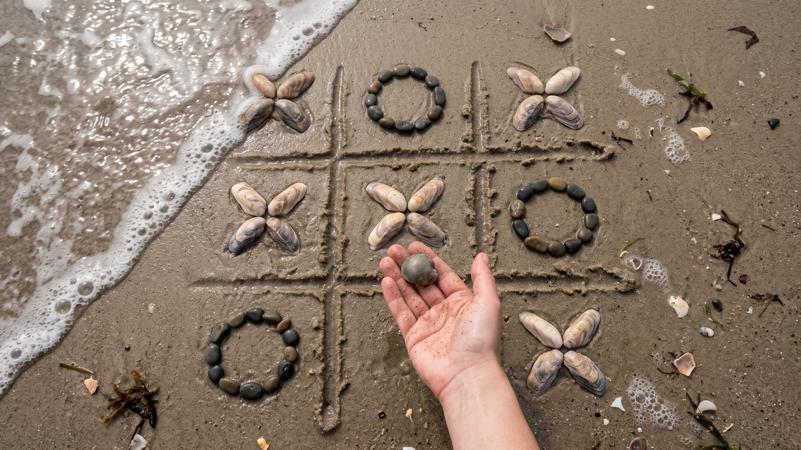
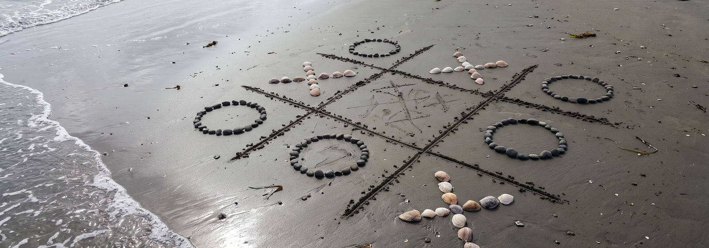
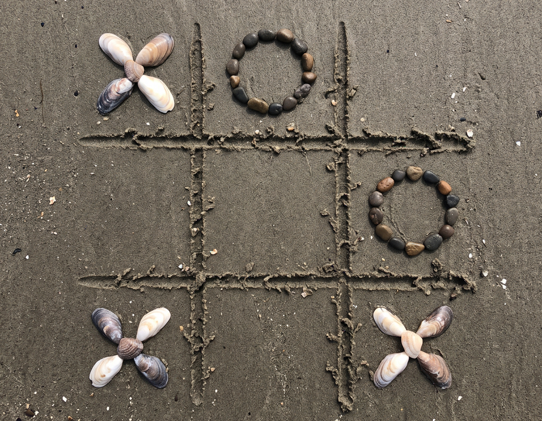

# Tic-Tac-Toe-Minimax



<p align="center"></p>


> **Seized goods tag:** --hard belongs only beside --cpu, and Ctrl-C or closed input at a move abandons that game with no score change.


A basic Python Tic-Tac-Toe-Minimax game for the terminal. Play against a friend on the
same keyboard, or against the computer.

Requirements: Python 3, standard library only.

## Features

- Two-player mode on one terminal
- Computer opponent with two difficulties:
  - Casual: takes wins, blocks losses, prefers the center, otherwise plays
    a random free cell
  - Hard: minimax play, unbeatable (an exhaustive game-tree check following
    the computer's moves found 0 human wins)
- Running score across rounds (X wins, O wins, draws)
- No dependencies: standard library only

## Run

```sh
python3 tic_tac_toe.py            # asks which mode you want
python3 tic_tac_toe.py --pvp      # two human players
python3 tic_tac_toe.py --cpu      # you are X, computer is O
python3 tic_tac_toe.py --cpu --hard
```

`--hard` only applies with `--cpu`; combining `--hard` with `--pvp` is
rejected with an argparse error and exit status 2.

Cells are numbered 1 to 9 as shown on the board:

```
 1 | 2 | 3
---+---+---
 4 | 5 | 6
---+---+---
 7 | 8 | 9
```

Type the number of the cell you want. An entry that is not a number from 1
to 9, or a cell that is already taken, is rejected with a message and the
same player is asked again. At the mode prompt, enter `1` for two players,
`2` for the computer, or `q` to quit; anything else prints
`Please enter 1, 2, or q.` and asks again instead of starting a game.

After each game the score is printed and you can play again with `y`. Any
other answer ends the session and prints the final score. Closing input
(EOF) or pressing Ctrl-C at a move prompt abandons the current game
without changing the score, and EOF or Ctrl-C at the mode or play-again
prompt ends the session. Exit status is 0.

## Tests

```sh
python3 -m unittest
```

32 tests: every win line for both marks, the win-on-the-last-move rule,
the casual computer's win, block, and center order, an exhaustive
game-tree walk proving the hard computer never loses as X or as O, move
entry (including the superscript character that passes `isdigit()` but
crashes `int()`), scripted games and menu sessions, and EOF and Ctrl-C
at each prompt.

## Files

- `tic_tac_toe.py` - the whole game
- `test_tic_tac_toe.py` - the test suite
- `logo.png`, `banner.png` - project branding
- `LICENSE` - MIT license

## License

MIT (see LICENSE).
